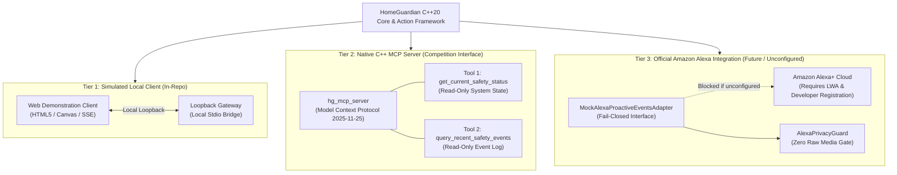

# HomeGuardian AI — Alexa & Alexa+ Integration Boundary Specification

## Executive Summary

To preserve strict privacy, truthful documentation, and competition integrity, HomeGuardian AI establishes an unequivocal architectural boundary between local demonstration clients, the native C++ Model Context Protocol (MCP) server, and potential official Amazon Alexa services.

HomeGuardian AI is **self-hosted, edge-first, and local-only**. It does not require Amazon cloud services, does not exfiltrate raw media, and does not claim to be an official Amazon product.

---

## 1. The 3-Tier Integration Architecture

---

## 2. Tier Details & Responsibilities

### Tier 1: Simulated Local Demonstration Client
- **Purpose**: Provides a local visual demonstration interface for evaluators and operators.
- **Location**: `src/web/`, `web_mcp/server.js`.
- **Characteristics**:
  - Connects strictly to localhost via local HTTP / Server-Sent Events (SSE) or stdio.
  - Generates synthetic and playback sensor feeds for demonstration scenarios.
  - **Truthful Boundary**: This is a simulated client built for hackathon evaluation. It is **not** an Amazon Echo device, nor does it run proprietary Alexa voice services.

### Tier 2: Native C++ Model Context Protocol (MCP) Server
- **Purpose**: The frozen competition interface for Hackathon 2026. Exposes ambient safety intelligence to LLM agents (such as Claude, Hermes, or Alexa+) using the open Anthropic Model Context Protocol (MCP specification version `2025-11-25`).
- **Binary**: `./build/hg_mcp_server`.
- **Tools**: Exactly **two read-only** inspection tools:
  1. `get_current_safety_status`: Returns current system readiness, active cameras, and consent state.
  2. `query_recent_safety_events`: Returns recent safety detections and alert summaries.
- **Characteristics**:
  - Stateless Streamable HTTP transport on localhost (`127.0.0.1:8080/mcp`).
  - Read-only: Cannot trigger physical changes or modify system state.
  - Unaffected by Roadmap R1: The competition MCP interface remains completely frozen.

### Tier 3: Official Amazon Smart Home / Proactive Events Adapter
- **Purpose**: Potential future integration with Amazon Alexa Smart Home Skills and Proactive Events API.
- **Contract**: `AlexaProactiveSecurityEvent` (defined in `src/action/AlexaIntegrationBoundary.h`).
- **Characteristics**:
  - **Fail-Closed by Default**: If Amazon Developer or Login with Amazon (LWA) credentials are not configured, all outbound calls fail immediately (`ExecutionState::Failed`).
  - **Metadata Only**: Dispatches structured JSON security events with detection type (`"FALL_DETECTED"`, `"MOTION_ACTIVITY"`), threat level (`"LOW"`, `"MEDIUM"`, `"HIGH"`), and timestamp.
  - **Strict Privacy Guard (`AlexaPrivacyGuard`)**: Rejects any payload containing raw audio (`"audio_samples"`, `"raw_audio"`, `"microphone_stream"`, `"pcm_data"`) or raw visual frames (`"video_frames"`, `"raw_media"`, `"camera_stream"`, `"frame_buffer"`).

---

## 3. Privacy & Compliance Guarantees

1. **Zero Raw Media Exfiltration**:
   - Neither video frames nor microphone PCM data ever leave the local boundary.
   - All inferences (fall detection, impact detection, room occupancy) happen on the local edge CPU/device.
2. **Consent-Gated Processing**:
   - Any revocation in `ConsentGate` immediately cuts off both event ingestion and proactive notification dispatch.
3. **No Emergency Services Contact**:
   - HomeGuardian AI explicitly does not dial 911, call PSAP dispatchers, or interface with municipal emergency networks. All notifications remain strictly local and informational.
