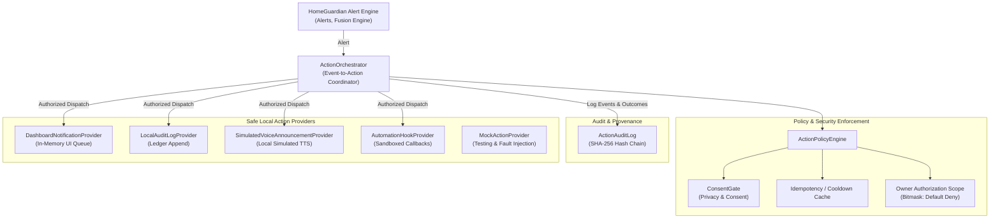
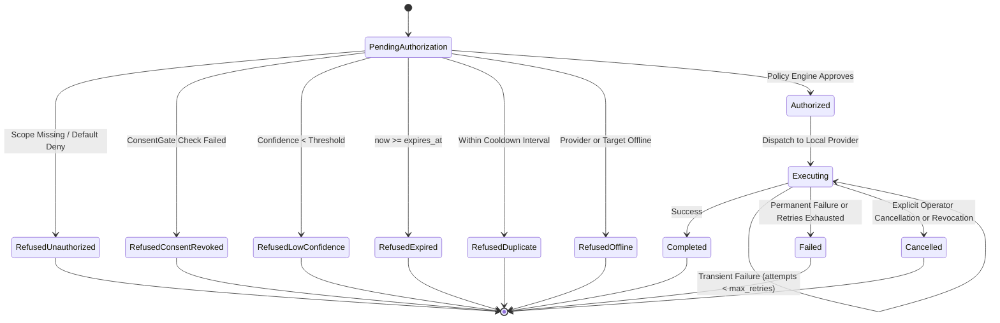

# HomeGuardian AI — Authorized Action Orchestration Architecture (Roadmap R1)

## Overview & Mission

HomeGuardian AI is an edge-first, privacy-preserving residential ambient intelligence and safety platform. Roadmap R1 introduces a **secure, local-first Action Orchestration Framework** (`homeguardian::action`) that consumes alerts generated by the core detection and sensor fusion engine, and executes **only explicitly authorized local actions**.

### Core Invariants

1. **Default-Deny Authorization**: No action is dispatched without explicit owner-granted authorization scopes. By default, the authorization mask is `ScopeNone` (0x0).
2. **Local-First Boundary**: Action execution targets local-only providers (in-memory dashboard queue, cryptographic audit ledger, simulated local speaker, and sandboxed automation hooks). Real-world external actions, emergency dispatching, and outbound cellular/PSTN communication are strictly excluded.
3. **Cryptographic Tamper-Evidence**: Every request, evaluation decision, retry attempt, cancellation, and execution outcome is appended to an append-only ledger (`ActionAuditLog`) structured as a cryptographic SHA-256 hash chain with genesis anchor.
4. **Consent-Enforced (Fail-Closed)**: If consent for a source sensor or target endpoint is revoked or ungranted via `ConsentGate`, action dispatch fails closed immediately (`RefusedConsentRevoked`).
5. **Idempotency & Duplicate Suppression**: Actions carry idempotency keys. Repeated identical alerts within an active cooldown window are suppressed (`RefusedDuplicate`).

---

## 1. Architectural Components

---

## 2. Versioned Contracts (`hg-action/1.0.0`)

The orchestration framework defines strict semantic versioning for requests and results.

### 2.1 `ActionRequest`

| Field | Type | Description |
|---|---|---|
| `contract_version` | `string` | Semantic contract version (`"hg-action/1.0.0"`). |
| `request_id` | `string` | Unique identifier for this action request (`act-req-<ts>-<counter>`). |
| `alert_id` | `string` | Associated HomeGuardian `alert_id` that triggered the request. |
| `event_id` | `string` | Contributing event identifier. |
| `source_identity` | `string` | Originating device or sensor ID (used for consent validation). |
| `action_type` | `ActionType` | Action category enum (`DashboardNotification`, `AuditEventGeneration`, etc.). |
| `target` | `string` | Target endpoint or display channel (e.g. `"local-dashboard"`, `"hallway-speaker"`). |
| `payload` | `json` | Structured metadata and message content for execution. |
| `required_scope` | `AuthorizationScope` | Required owner authorization scope bit. |
| `consent_version` | `string` | Active consent version at request generation time. |
| `created_at` | `time_point` | UTC creation timestamp. |
| `expires_at` | `time_point` | UTC expiration timestamp. Expired requests are refused. |
| `idempotency_key` | `string` | Unique key for deduplication and cooldown enforcement. |
| `provenance` | `string` | Rule or detector provenance string (e.g., `"FallDetectionRule"`). |
| `confidence` | `double` | Upstream detection confidence `[0.0, 1.0]`. |
| `max_retries` | `uint32_t` | Maximum allowed retry attempts for transient failures (default: 3). |
| `retry_count` | `uint32_t` | Current retry attempt index. |

### 2.2 `ActionResult`

| Field | Type | Description |
|---|---|---|
| `contract_version` | `string` | Semantic contract version (`"hg-action/1.0.0"`). |
| `request_id` | `string` | Correlates to original `ActionRequest::request_id`. |
| `idempotency_key` | `string` | Deduplication key for tracking. |
| `action_type` | `ActionType` | Category of executed action. |
| `state` | `ExecutionState` | Lifecycle execution state (see State Machine below). |
| `success` | `bool` | True only if action completed successfully. |
| `failure_reason` | `string` | Detailed rationale if action failed or was refused. |
| `executed_at` | `time_point` | Timestamp of completion or terminal state. |
| `duration_ms` | `uint64_t` | Execution duration in milliseconds. |
| `output` | `json` | Provider-specific output metadata. |
| `audit_id` | `string` | Cryptographic SHA-256 hash in `ActionAuditLog`. |
| `attempts` | `uint32_t` | Total attempts executed (initial + retries). |

---

## 3. Lifecycle State Machine

---

## 4. Policy Engine & Security Controls (Task D)

The `ActionPolicyEngine` enforces eight sequential defense-in-depth security checks:

1. **Expiration Verification**: `now >= request.expires_at` -> `RefusedExpired`.
2. **Offline Fail-Closed**: `!is_target_online` -> `RefusedOffline`.
3. **Duplicate & Cooldown Suppression**: Checks `cooldown_cache_`. If an execution was recorded within `rule.cooldown` -> `RefusedDuplicate`.
4. **Policy Rule Matching**: Matches rule by `rule_name`, `request.provenance`, or payload. If no matching rule exists -> `RefusedUnauthorized` (Default Deny).
5. **Owner Scope Authorization**: Evaluates bitmask `has_scope(granted_scopes_, rule.required_scope)`. If ungranted -> `RefusedUnauthorized`.
6. **Confidence Threshold**: Ensures `request.confidence >= rule.min_confidence`. Prevents low-confidence or experimental detections from triggering actions -> `RefusedLowConfidence`.
7. **Consent Gate Revocation**: If `rule.requires_explicit_consent`, calls `ConsentGate` callback for both `source_identity` and `target`. If consent is missing or revoked -> `RefusedConsentRevoked`.
8. **In-Flight Cancellation**: `ActionOrchestrator::cancel_action(request_id)` or `revoke_device_actions(device_id)` cooperatively halts in-flight retries.

---

## 5. Local Action Providers (Task B)

All action providers implement the abstract `IActionProvider` interface:

1. **`DashboardNotificationProvider`**:
   - Manages an in-memory FIFO queue of notifications for local operator displays.
   - Enforces configurable capacity (`max_history`), drops oldest upon capacity limit.
   - Supports offline simulation, active query, and history clearing.
2. **`LocalAuditLogProvider`**:
   - Dispatches explicit audit records directly to `ActionAuditLog`.
3. **`SimulatedVoiceAnnouncementProvider`**:
   - Synthesizes simulated local text-to-speech phrases on authorized local speakers.
   - Zero physical speaker capture or microphone opening; text simulation only.
4. **`AutomationHookProvider`**:
   - Sandboxed local callback registry (`std::function<json(const ActionRequest&)>`).
   - Validates hook identifiers; rejects unregistered hooks or external URL triggers.
5. **`MockActionProvider`**:
   - Test fixture providing failure injection, transient retry simulation (`fail_first_n_times`), and latency simulation.

---

## 6. Cryptographic Audit Log (`ActionAuditLog`)

- **Structure**: Append-only sequence of `ActionAuditEntry` structs.
- **Hash Chaining**:
  $$\text{Hash}_0 = \text{SHA-256}(\text{"GENESIS-ACTION-AUDIT-LOG-1.0"})$$
  $$\text{Hash}_i = \text{SHA-256}(\text{Seq}_i \parallel \text{Timestamp}_i \parallel \text{ReqId}_i \parallel \text{Event}_i \parallel \text{State}_i \parallel \text{Hash}_{i-1})$$
- **Tamper Evidence**: `verify_chain_integrity()` verifies the forward hash pointer for every entry. Any modified, inserted, or reordered record breaks chain verification.
- **Auditing Exports**: Offers structured exports in JSON (`to_json_export()`) and standard RFC 4180 CSV (`to_csv_export()`).
