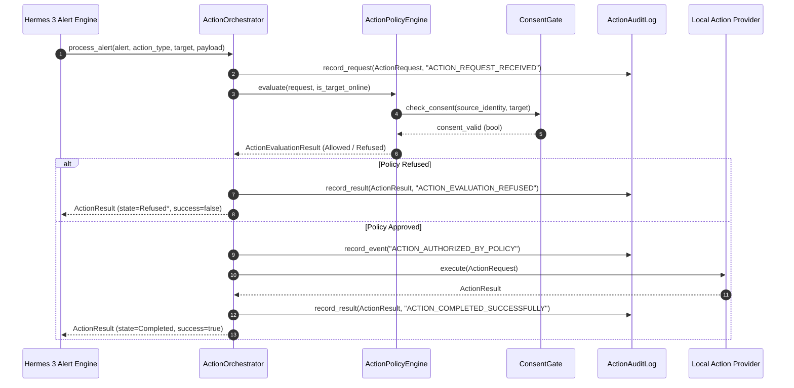

# HomeGuardian AI — Hermes 3 Alert Engine Handoff Specification

## 1. Context & Purpose

This document provides the formal interface specification for integrating the future **Hermes 3 Alert Engine** with the HomeGuardian AI **Authorized Action Orchestrator** (`homeguardian::action`).

All work is developed in the isolated experimental branch `experiment/hg-authorized-actions`. The competition release (PR #20) remains completely frozen.

---

## 2. Integration Architecture

Hermes 3 acts as the upstream producer of high-level correlated alerts. When Hermes 3 determines an anomaly or critical event requires a local action, it delegates to `ActionOrchestrator::process_alert(...)`.



---

## 3. Producer Contract: Required `Alert` Attributes

When Hermes 3 constructs an `Alert` (`src/core/Alert.h`), it must populate:

```cpp
Alert alert = Alert::create(
    alert_id,                 // e.g. "alert-hermes3-fall-001" (non-empty string)
    severity,                 // Severity::critical, Severity::warning, or Severity::info
    message,                  // Human-readable summary (e.g. "Critical fall impact detected in bedroom")
    contributing_event_ids,   // vector<string> of causal sensor observation IDs
    confidence,               // double in [0.0, 1.0] (must satisfy policy min_confidence)
    rule_name,                // Provenance rule name matching policy (e.g. "Hermes3FallDetectionRule")
    details                   // nlohmann::json with {"device_id": "sensor-01", ...}
);
```

### Critical Field Mapping in `ActionOrchestrator::process_alert`:
- `request.source_identity` $\leftarrow$ `alert.details.value("device_id", "system-sensor-bridge")`
- `request.provenance` $\leftarrow$ `alert.rule_name`
- `request.confidence` $\leftarrow$ `alert.confidence`
- `request.idempotency_key` $\leftarrow$ `alert.alert_id + ":" + action_type_to_string(action_type)`

---

## 4. Setup & Policy Initialization for Hermes 3

Before processing alerts, Hermes 3 must initialize and configure the policy engine and action orchestrator:

```cpp
#include "action/ActionOrchestrator.h"
#include "action/LocalActionProviders.h"
#include "core/ConsentGate.h"

// 1. Instantiate shared components
auto policy_engine = std::make_shared<homeguardian::action::ActionPolicyEngine>();
auto audit_log = std::make_shared<homeguardian::action::ActionAuditLog>();
auto orchestrator = std::make_shared<homeguardian::action::ActionOrchestrator>(policy_engine, audit_log);

// 2. Register local-only action providers
auto dash_provider = std::make_shared<homeguardian::action::DashboardNotificationProvider>();
auto voice_provider = std::make_shared<homeguardian::action::SimulatedVoiceAnnouncementProvider>();
orchestrator->register_provider(dash_provider);
orchestrator->register_provider(voice_provider);

// 3. Connect ConsentGate callback
orchestrator->policy_engine()->set_consent_checker([](const std::string& device_id) {
    return homeguardian::ConsentGate::get_instance().is_consent_granted(device_id);
});

// 4. Grant explicit owner authorization scopes
uint32_t granted = homeguardian::action::AuthorizationScope::ScopeLocalNotify |
                   homeguardian::action::AuthorizationScope::ScopeLocalVoice;
orchestrator->policy_engine()->set_granted_scopes(granted);

// 5. Register policy rules
homeguardian::action::ActionPolicyRule fall_rule;
fall_rule.rule_name = "Hermes3FallDetectionRule";
fall_rule.action_type = homeguardian::action::ActionType::DashboardNotification;
fall_rule.required_scope = homeguardian::action::AuthorizationScope::ScopeLocalNotify;
fall_rule.min_confidence = 0.80;  // Reject experimental detections below 80%
fall_rule.cooldown = std::chrono::milliseconds(5000); // 5-second deduplication
fall_rule.requires_explicit_consent = true;
orchestrator->policy_engine()->add_rule(fall_rule);
```

---

## 5. Invariants for Hermes 3 Developers

1. **Never Bypass Policy Engine**: Never invoke `IActionProvider::execute()` directly. All actions must transit `ActionOrchestrator::process_alert()` to guarantee policy verification, consent checks, and audit logging.
2. **Never Dispatch Real Emergency Services**: The `EmergencyEscalation` action type is fenced and default-denied. All actions must remain local-first (in-memory dashboard, local audio synthesis, audit logging).
3. **Verify Audit Chain Integrity**: Hermes 3 test suites should verify `audit_log->verify_chain_integrity()` upon shutdown to ensure zero ledger tampering.
